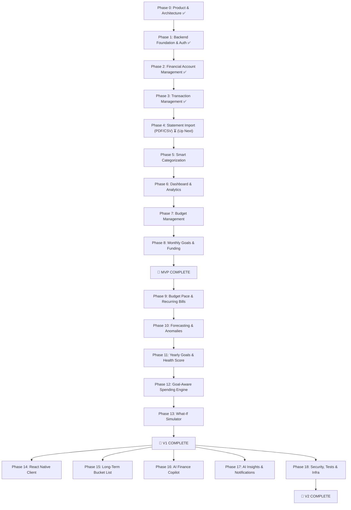

# AI-Driven Personal Finance Copilot — Implementation Roadmap & Status

This document tracks the phased development roadmap of the AI-Driven Personal Finance Copilot platform across the **Track**, **Plan**, **Achieve**, and **AI Copilot** functional pillars.

---

## 🗺️ Release Milestones Overview

---

## Current Status Summary

| Phase | Title | Milestone | Status |
|---|---|---|---|
| **Phase 0** | Product Architecture & System Specs | Foundation | **Completed** ✅ |
| **Phase 1** | Backend Foundation & Authentication | MVP | **Completed** ✅ |
| **Phase 2** | Financial Account Management *(Optional/Non-mandatory)* | MVP | **Completed** ✅ |
| **Phase 3** | Transaction Management | MVP | **Completed** ✅ |
| **Phase 4** | Statement Import & Ingestion | MVP | **Completed** ✅ |
| **Phase 5** | Smart Categorization | MVP | **Completed** ✅ |
| **Phase 6** | Financial Dashboard & Analytics | MVP | **Completed** ✅ |
| **Phase 7** | Budget Management | MVP | **Completed** ✅ |
| **Phase 8** | Monthly Goals & Goal Funding | MVP | **Completed** ✅ |
| **Phase 9** | Budget Pace & Recurring Payments | V1 | Backlog |
| **Phase 10** | Forecasting & Anomaly Detection | V1 | Backlog |
| **Phase 11** | Yearly Goals & Goal Intelligence | V1 | Backlog |
| **Phase 12** | Goal-Aware Spending Engine | V1 | Backlog |
| **Phase 13** | What-If Simulator | V1 | Backlog |
| **Phase 14** | React Native Mobile Application | V2 | Backlog |
| **Phase 15** | Long-Term Bucket List Goals | V2 | Backlog |
| **Phase 16** | AI Finance Copilot (Conversational) | V2 | Backlog |
| **Phase 17** | AI Spending Insights & Notifications | V2 | Backlog |
| **Phase 18** | Security Hardening & Production Infra | V2 | Backlog |

---

## Detailed Phase Breakdown & Progress

### Phase 0 — Product Architecture & Specification
- [x] Continuous financial lifecycle definition (Track → Plan → Achieve → AI Copilot)
- [x] Hybrid data ingestion strategy (Account Aggregator, PDF/CSV parsing, notifications, manual entry)
- [x] Mathematical formulations for budget velocity, month-end run rates, and goal delay calculations
- [x] Decoupling deterministic financial engine from generative conversational AI
- [x] 26-capability feature taxonomy and phased roadmap (MVP, V1, V2)

---

### Phase 1 — Backend Foundation & Authentication
> **Completed:** Tested and verified against PostgreSQL 17 & Redis (`npm run test:auth`).

#### Project Setup
- [x] Initialize Node.js + TypeScript
- [x] Configure Express
- [x] Configure ESLint
- [x] Configure Prettier
- [x] Configure environment variables (`src/config/env.ts` with Zod validation)
- [x] Create application bootstrap (`src/server.ts` with graceful shutdown)
- [x] Create error-handling middleware (`src/middlewares/error.middleware.ts`, `src/errors/app-error.ts`)
- [x] Create request logging (`src/middlewares/logger.middleware.ts`)
- [x] Create validation middleware (`src/middlewares/validate.middleware.ts`)

#### Architecture
- [x] Controller layer (`src/controllers/auth.controller.ts`, `src/controllers/health.controllers.ts`)
- [x] Service layer (`src/services/auth.service.ts`, `src/services/session.service.ts`, `src/services/health.service.ts`)
- [x] Repository layer (`src/repositories/user.repository.ts`)
- [x] Route layer (`src/routes/auth.routes.ts`, `src/routes/health.routes.ts`)
- [x] Database layer (`src/db/schema.sql`, `src/db/migrate.ts`, `src/config/database.ts`, `src/config/redis.ts`)
- [x] Shared utilities (`src/utils/response.ts`, `src/utils/password.ts`, `src/utils/jwt.ts`)

#### Authentication
- [x] User registration (`POST /api/auth/register`)
- [x] Login (`POST /api/auth/login`)
- [x] Password hashing (`bcryptjs` with 12 salt rounds)
- [x] JWT authentication (Bearer token validation)
- [x] Refresh-token / session strategy (Redis-backed session with token rotation)
- [x] Logout (`POST /api/auth/logout` revoking Redis session)
- [x] Authentication middleware (`src/middlewares/auth.middleware.ts`)
- [x] User profile (`GET /api/auth/profile`, `PATCH /api/auth/profile`)

---

### Phase 2 — Financial Account Management
> **Completed:** Accounts & cards are **100% non-mandatory / optional**. Tested and verified with `npm run test:accounts`.
- [x] Design accounts table (`id`, `user_id`, `name`, `type`, `balance`, `currency`, `credit_limit`, `is_archived`, `is_default`)
- [x] Create account repository (`src/repositories/account.repository.ts`)
- [x] Create account service (`src/services/account.service.ts`)
- [x] Create account controller (`src/controllers/account.controller.ts`)
- [x] Create account routes (`src/routes/account.routes.ts`)
- [x] Add bank account (`POST /api/accounts` with `type: 'bank'`)
- [x] Add credit card (`POST /api/accounts` with `type: 'credit_card'`)
- [x] Add cash account (`POST /api/accounts` with `type: 'cash'`)
- [x] Add UPI / wallet account (`POST /api/accounts` with `type: 'upi_wallet'`)
- [x] Edit account (`PATCH /api/accounts/:id`)
- [x] Delete / archive account (`DELETE /api/accounts/:id` and `POST /api/accounts/:id/archive`)
- [x] View account balances & financial summary (`GET /api/accounts/summary`)
- [x] Associate accounts with authenticated users & enforce tenant isolation
- [x] Graceful zero-account handling (users with 0 accounts receive empty list & zero summary without errors)

---

### Phase 3 — Transaction Management
> **Completed:** Full support for unlinked/cash tracking, inter-account transfers, and atomic balance syncing. Tested with `npm run test:transactions`.
- [x] Design transaction schema (`id`, `user_id`, `account_id`, `to_account_id`, `type`, `amount`, `currency`, `category`, `merchant`, `description`, `date`, `payment_rail`, `is_recurring`, `tags`)
- [x] Define transaction types (Income, Expense, Transfer)
- [x] Create transaction repository (`src/repositories/transaction.repository.ts`)
- [x] Create transaction service with atomic balance synchronization (`src/services/transaction.service.ts`)
- [x] Create transaction APIs & validation (`src/routes/transaction.routes.ts`, `src/schemas/transaction.schema.ts`)
- [x] Add transaction (`POST /api/transactions`)
- [x] Edit transaction with balance delta adjustments (`PATCH /api/transactions/:id`)
- [x] Delete transaction with balance reversal (`DELETE /api/transactions/:id`)
- [x] View transaction (`GET /api/transactions/:id`)
- [x] List transactions with total count & pagination (`GET /api/transactions`)
- [x] Search transactions (keyword matching against merchant, description, category)
- [x] Filter by date range (`startDate`, `endDate`)
- [x] Filter by account (`accountId`)
- [x] Filter by category (`category`)
- [x] Sort transactions (`sortBy=date|amount|created_at`, `sortOrder=ASC|DESC`)
- [x] Pagination (`limit`, `offset`)
- [x] Validate transaction amounts & transfer constraints
- [x] Prevent invalid account ownership (strict cross-user tenant isolation)

---

### Phase 4 — Statement Import & Transaction Ingestion
#### CSV Ingestion
- [x] CSV upload endpoint
- [x] File validation
- [x] Column auto-detection
- [x] Transaction extraction
- [x] Date & amount normalization
- [x] Merchant extraction
#### PDF Ingestion
- [x] PDF upload endpoint
- [x] Text extraction
- [x] OCR fallback for scanned PDFs (via configurable `OCR_ENDPOINT`)
- [x] Bank-statement date, amount, debit/credit, narration, and common merchant parsing rules
#### Import Workflow
- [x] Preview extracted transactions
- [x] Detect duplicates (SHA-256 fingerprint; enforced again during confirmation)
- [x] User review & correction
- [x] Batch persist transactions
- [x] Ingestion history logging

---

### Phase 5 — Smart Categorization
- [x] Define category taxonomy
- [x] Create categories database table
- [x] Merchant string normalization
- [x] Keyword matching (MCC mapping reserved until MCC data is ingested)
- [x] Merchant mapping rules
- [x] Category assignment with confidence scoring
- [x] User correction override & learned merchant rules
- [x] Handle unknown merchants
- [x] Per-user TF-IDF classifier for ambiguous strings

---

### Phase 6 — Financial Dashboard & Analytics
- [x] Calculate monthly income, expenses, net savings
- [x] Calculate savings rate percentage
- [x] Category breakdown & account breakdowns
- [x] Spending by day / week / month
- [x] Month-over-month comparison & category variance
- [x] Largest transactions & top spending categories

---

### Phase 7 — Budget Management
- [x] Monthly budget creation & category limits
- [x] Overall spending limit
- [x] Budget utilization percentage & remaining budgets
- [x] Budget vs. actual spending calculations
- [x] Budget APIs & dashboard summary

---

### Phase 8 — Monthly Goals & Goal Funding
- [x] Short-term target tracking
- [x] Goal funding allocations
- [x] Deterministic savings rate calculator
- [x] Goal progress visualizations
*(MVP Completes Here)*

---

### Phases 9 to 13 — Version 1.0 (V1)
- [ ] **Phase 9:** Budget Pace Velocity ($V_{\text{ideal}}$, $\Delta V$) & Recurring Payments Detection
- [ ] **Phase 10:** Month-End Forecasting & Anomaly Outlier Detection
- [ ] **Phase 11:** Yearly Goals, Dynamic Goal Health (🟢/🟡/🔴), & Waterfall Prioritization
- [ ] **Phase 12:** Goal-Aware Spending Engine (Connecting overspends to completion delays)
- [ ] **Phase 13:** What-If Simulator & Pre-purchase Decision Engine

---

### Phases 14 to 18 — Version 2.0 (V2) & Production
- [ ] **Phase 14:** Cross-platform React Native / Expo Mobile Application
- [ ] **Phase 15:** Long-Term Bucket List Planning (Multi-year lifestyle targets)
- [ ] **Phase 16:** AI Finance Copilot (Natural Language Intent Parser + Explanations)
- [ ] **Phase 17:** AI Spending Insights & Proactive Smart Push Notifications
- [ ] **Phase 18:** Production Security, Comprehensive Tests, Docker & CI/CD Pipeline
